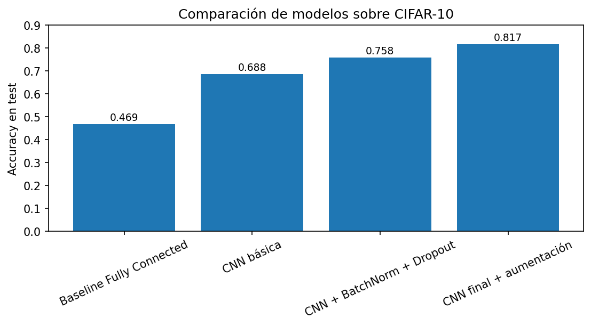
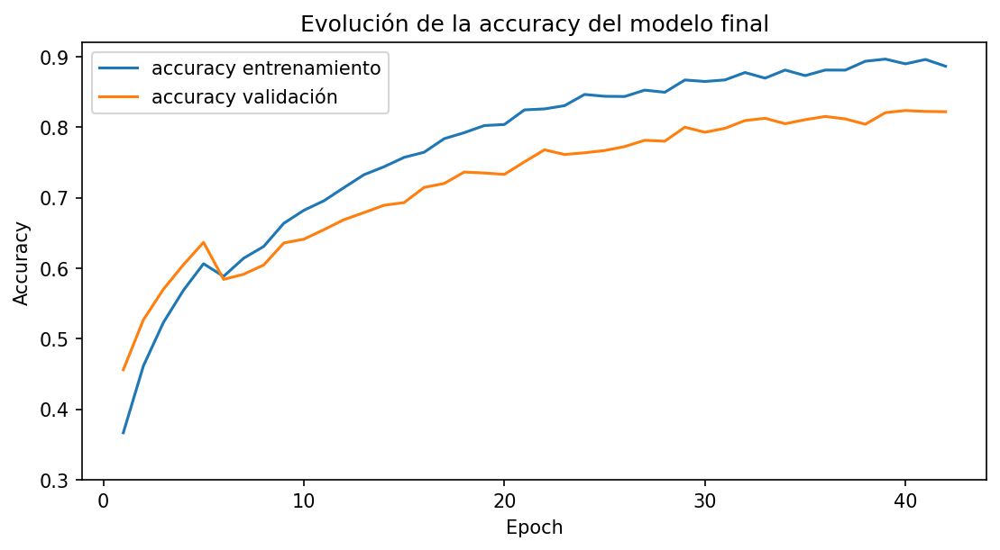
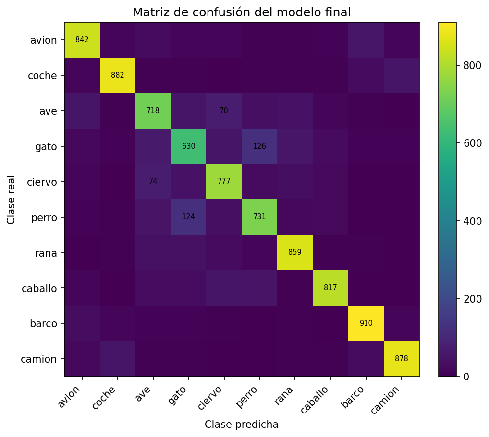
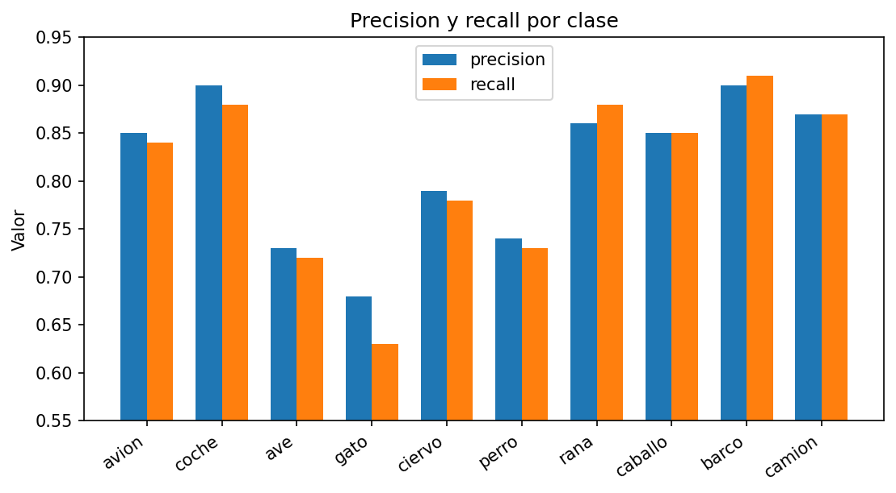

# Clasificación de imágenes CIFAR-10 con redes convolucionales


Estudio progresivo de arquitecturas para clasificar las 10 clases de **CIFAR-10**
(60.000 imágenes RGB de 32×32): desde una red densa de referencia hasta una CNN
regularizada con aumentación de datos que alcanza un **81,7 % de accuracy en test**.

## Resultados

| Modelo | Arquitectura | Parámetros | Accuracy test | Loss test |
|---|---|---:|---:|---:|
| Fully connected (referencia) | Flatten + Dense(512) + Dense(256) | 1.707.274 | 0.4687 | 1.4932 |
| CNN básica | 2 bloques Conv2D + MaxPooling | 122.570 | 0.6879 | 0.8897 |
| CNN + BatchNorm + Dropout | 3 bloques convolucionales dobles | 816.938 | 0.7584 | 0.6871 |
| **CNN final** | Igual + aumentación + L2 + callbacks | 816.938 | **0.8172** | **0.5486** |

<p align="center">
  
</p>

Cada decisión de diseño aporta una mejora medible:

- **Convoluciones** (+21,9 puntos): explotan la estructura espacial local que una red densa
  pierde al aplanar la imagen, con 14 veces menos parámetros.
- **Batch Normalization + Dropout** (+7,1 puntos): estabilizan el entrenamiento de una red
  más profunda y reducen el sobreajuste.
- **Aumentación de datos + L2 + `EarlyStopping` + `ReduceLROnPlateau`** (+5,9 puntos):
  mejoran la generalización. La diferencia entre la mejor validación (0.8236) y test es de solo 0.0064.

## Análisis del modelo final

| Curvas de entrenamiento | Matriz de confusión |
|---|---|
|  |  |

- Las mejores clases son **barco** (precision ≈ 0.90, recall ≈ 0.91), **coche**
  (≈ 0.90 / 0.88), **camión**, **rana** y **caballo**.
- La clase más difícil es **gato** (precision ≈ 0.68, recall ≈ 0.63). Los errores se
  concentran en animales visualmente similares: **126 gatos** clasificados como perro y
  **124 perros** como gato.

<p align="center">
  
</p>

## Técnicas aplicadas

- Partición entrenamiento / validación / test (40.000 / 10.000 / 10.000) y normalización a [0, 1].
- Aumentación en el propio modelo: `RandomFlip`, `RandomRotation`, `RandomZoom`, `RandomTranslation`.
- Regularización: `BatchNormalization`, `Dropout` y penalización **L2**.
- Callbacks: `EarlyStopping` (restaurando los mejores pesos) y `ReduceLROnPlateau`.
- Evaluación: accuracy, precision, recall y F1 por clase, matriz de confusión e inspección de errores.

## Ejecución

```bash
pip install -r requirements.txt
jupyter notebook cifar10_cnn_classification.ipynb
```

El dataset se descarga automáticamente con `tf.keras.datasets.cifar10`. Se recomienda GPU
para el entrenamiento del modelo final.

## Estructura

```
├── cifar10_cnn_classification.ipynb   # Notebook completo con resultados
├── images/                            # Figuras de resultados
└── requirements.txt
```
